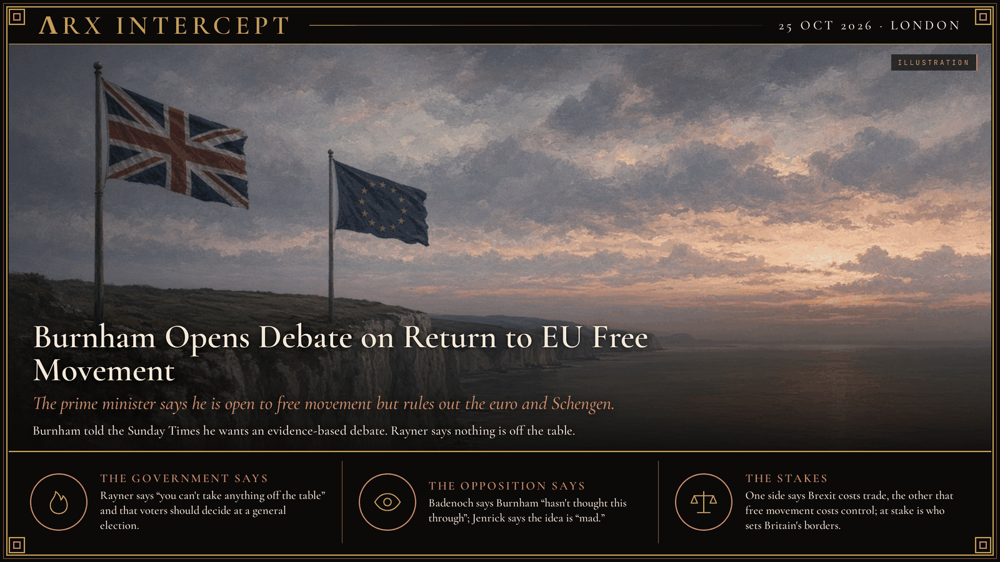

**ΛRX INTERCEPT** · Dispatch · 25 Oct 2026 · London

# Burnham Opens Debate on Return to EU Free Movement

*The prime minister says he is open to free movement but rules out the euro and Schengen.*

Burnham puts free movement back on the table, 10 years after Brexit.

Rayner says nothing is off limits. Badenoch says he hasn't thought it through. Jenrick calls it mad.

Burnham rules out the euro and Schengen. Brussels hears his pitch on 20 November.

Prime Minister Andy Burnham told the Sunday Times he would welcome an "honest discussion" about returning to free movement between the UK and the European Union. "I think you have to have a very factual, quite evidence-based debate about this," he said. Burnham says options for a new relationship could include full EU membership or joining the single market, which requires free movement. He says the pattern of migration has changed since 2016, but adds: "I can't see myself ever recommending anything that would involve joining the euro or Schengen."

Burnham has committed to Labour's 2024 manifesto, which ruled out free movement, single market membership and a customs union, so any change would need a mandate at a general election, due by 2029. He will meet EU leaders, including Commission President Ursula von der Leyen, at a summit in Brussels on 20 November. His predecessor, Keir Starmer, kept all three red lines. During the Makerfield by-election in June, Burnham told voters "now is not the time" to reopen the Brexit debate.

Housing Secretary Angela Rayner told BBC One's Sunday with Laura Kuenssberg that "you can't take anything off the table when you're having a conversation," but that the prime minister "is not saying we're going back to where we were in 2016." She says exports have fallen 20% and that voters should weigh the trade-offs at a general election. Conservative leader Kemi Badenoch says Burnham "hasn't thought this through." Reform UK's Robert Jenrick says the idea is "mad," and Reform leader Nigel Farage calls the stance a betrayal of Leave voters. The Liberal Democrats and pro-EU groups welcome it; one pro-EU estimate puts Brexit's cost at up to £240bn in lost growth.

One side says Brexit has cost Britain trade; the other says free movement would cost it control of its borders. Beneath both is the question the 2016 vote was meant to settle: who decides who may live and work in Britain.

---

## Sources

**Original reporting**
- [Burnham open to 'honest discussion' on EU free movement](https://www.bbc.com/news/articles/c8e36kyk1qx5o) — BBC News
- [Rayner says 'nothing off the table' for Burnham to undo harms of Brexit](https://www.independent.co.uk/news/uk/politics/brexit-angela-rayner-andy-burnham-rejoin-eu-budget-b3072929.html) — The Independent
- [Rayner says nothing off table in Burnham's talks with European Union](https://www.penarthtimes.co.uk/news/national/26667927.rayner-nothing-off-table-burnhams-talks-european-union/) — Penarth Times (PA)

**Framing**
- [Rayner says PM considering all options on relationship with EU](https://www.independent.co.uk/bulletin/news/burnham-angela-rayner-brexit-eu-b3072947.html) — The Independent (includes opposition reaction)

*Filed by the ΛRX Intercept desk · arxcortex.io*

*Grok Bot wrote this from the sources above, with human review before publishing.*
