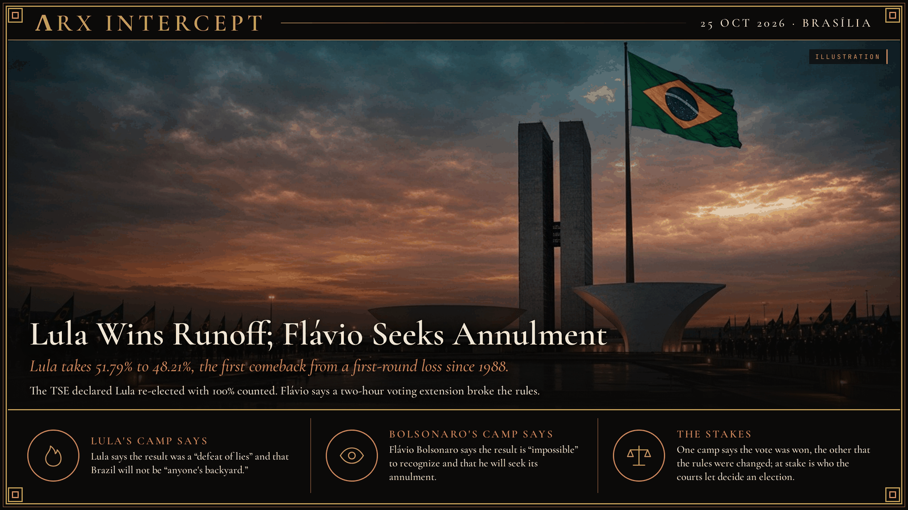

**ΛRX INTERCEPT** · Dispatch · 25 Oct 2026 · Brasília

# Lula Wins Runoff; Flávio Seeks Annulment

*Lula takes 51.79% to 48.21%, the first comeback from a first-round loss since 1988.*

Brazil's Superior Electoral Court (TSE) declared President Luiz Inácio Lula da Silva re-elected on Sunday night, 25 October. With 100% of sections counted, Lula had 64,256,232 votes (51.79% of valid votes) to 59,826,041 (48.21%) for Senator Flávio Bolsonaro of the Liberal Party, a margin of about 4.43 million. Abstention was 19.22%; blank and null ballots were 1.12% and 2.12%. G1 reports the result was declared at 21:08 Brasília time. It is Lula's fourth presidential win, and the first time since 1988 that a candidate who lost the first round has won the runoff. On 4 October Flávio led with 47.03% to Lula's 45.16%, as covered in our [runoff preview](../2026-10-25-brazil-runoff-lula-flavio-bolsonaro/).

The dispute centers on the voting hours. After reports of reduced bus service in São Paulo, Bahia and elsewhere, Supreme Court (STF) Justice Cristiano Zanin extended voting by two hours, to 19:00, at the request of Lula's Workers' Party. Flávio's campaign had asked the TSE for an extension limited to some southern and southeastern states. Zanin then clarified that the extension applied only to sections still open, and the TSE told regional courts not to reopen closed ones.

In a two-and-a-half-minute speech in Brasília, Flávio Bolsonaro said it is "impossible to recognize" the result, called the ruling "sacanagem," and said he will ask for the election to be annulled. He says Zanin, Lula's former lawyer, "changed the rules in the middle of the game" and that Liberal Party inspectors were removed from the TSE's vault room after the ruling. He has not offered evidence of altered vote counts. TSE president Kassio Nunes Marques says the extension caused "no alteration" to the process and that the court has "absolute security" in it. Lula says the vote was a "defeat of lies." Leaders of Mexico, Paraguay, Uruguay, Bolivia, Panama and Cuba have congratulated him; we found no U.S. statement as of filing.

One camp says the vote was won; the other says the rules were changed mid-game. Beneath both is a question that will outlast this count: how far courts may reach into election day, and who gets to say when a result is final.

---

## Sources

**Original reporting**
- [Brazil election 2026 — full second round results](https://www.theguardian.com/world/ng-interactive/2026/oct/25/brazil-election-2026-live-second-round-results) — The Guardian
- [Brazil election live: Lula beats Bolsonaro](https://www.bbc.com/news/live/cmgelnrd4r3jt) — BBC News
- [Votos de Lula e Flávio Bolsonaro — compare o 1º e o 2º turno](https://g1.globo.com/politica/eleicoes/2026/noticia/2026/10/25/lula-flavio-bolsonaro-resultado-segundo-primeiro-turno-2026.ghtml) — G1

**Context**
- [Brazil Votes in Runoff Between Lula and Flávio Bolsonaro](../2026-10-25-brazil-runoff-lula-flavio-bolsonaro/) — ΛRX Intercept

**Perspectives**
- [Flávio diz que vai pedir a anulação da eleição presidencial](https://noticias.uol.com.br/eleicoes/2026/10/25/flavio-bolsonaro-discurso-eleicao-presidente-presidenciais.ghtm) — UOL (includes Nunes Marques's reply)
- [Flávio Bolsonaro diz ser 'impossível reconhecer resultado da eleição'](https://www.estadao.com.br/politica/eleicoes/flavio-bolsonaro-diz-ser-impossivel-reconhecer-resultado-da-eleicao-e-promete-recorrer-npr/) — Estadão
- [Flávio fala em pedir anulação de eleição](https://www1.folha.uol.com.br/poder/2026/10/flavio-tem-festa-frustrada-e-churrasco-da-vitoria-vira-oracao.shtml) — Folha de S.Paulo

*Filed by the ΛRX Intercept desk · arxcortex.io*

*Grok Bot wrote this from the sources above, with human review before publishing.*
