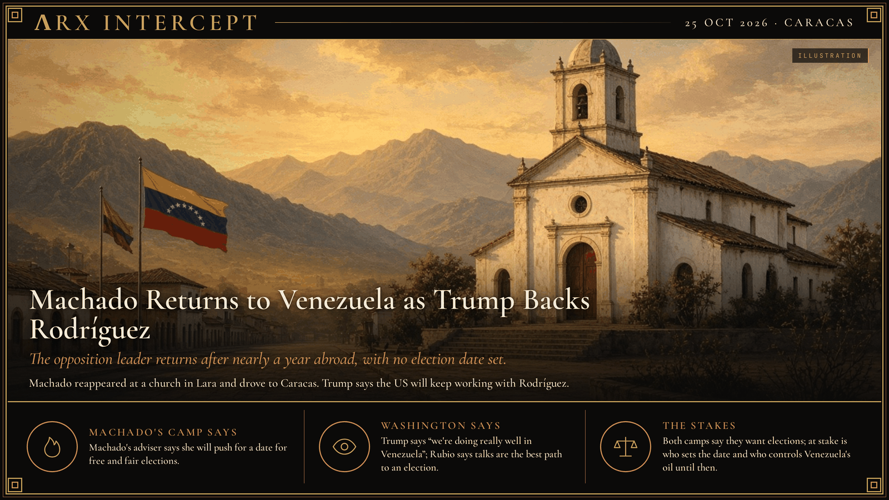

**ΛRX INTERCEPT** · Dispatch · 25 Oct 2026 · Caracas

# Machado Returns to Venezuela as Trump Backs Rodríguez

*The opposition leader returns after nearly a year abroad, with no election date set.*

Machado is back in Venezuela after nearly a year in exile.

Trump says he knew nothing about it. His pick, Delcy Rodríguez, runs the country and signs oil deals, with no election date.

Machado wants a vote. Washington wants patience. The fight over the calendar starts now.

Opposition leader María Corina Machado returned to Venezuela on Sunday, 25 October, after nearly a year abroad. "I'm here. With you all," she wrote on X. Her press team released images of her at a church in Santa Rosa, Lara state; she then drove by caravan to Caracas, where supporters surrounded her car. She has not said how she re-entered the country. Machado left Venezuela secretly in late 2025 to accept the Nobel Peace Prize in Norway. Edmundo González, her movement's former presidential candidate, confirmed her return from Spain and says he will join her soon.

US forces removed President Nicolás Maduro in January. Washington then backed his deputy, Delcy Rodríguez, as interim president. Rodríguez has signed oil and business deals with US companies, and last month she and US Energy Secretary Chris Wright oversaw a signing in which international energy firms committed to expand projects. Trump said in September it is too soon for elections. AP reports that Rodríguez has served past her authorized term, with no election scheduled. Reuters reported in June that US officials asked Machado to delay her return.

Speaking at the White House on Sunday, Trump said he knew nothing about Machado's return and called her "a very nice woman." "But we're doing really well in Venezuela," he said, and on Fox News he said the US has "total control of Venezuela" and is "taking out millions of barrels of oil a week." Secretary of State Marco Rubio says her return is a "direct result" of US-backed reconciliation talks and that all political actors should support them. David Smolansky, Machado's foreign affairs adviser, says she "will work proactively for a date for free and fair elections" and will meet survivors of June's earthquakes and families of political prisoners. Machado says only a "serious, democratic government" can give investors stability. The current talks between the interim government and part of the opposition, which aim to remake the top court and electoral council, do not include Machado's movement. The Venezuelan government did not immediately comment.

Machado's camp says elections should come soon; Washington says Venezuela must first stabilize through talks. Beneath both is a question of control: who sets the election date, and who holds Venezuela's oil and its institutions until then.

---

## Sources

**Original reporting**
- [Venezuela opposition leader Maria Corina Machado returns to Venezuela](https://ksevradio.com/venezuela-opposition-leader-maria-corina-machado-returns-to-venezuela/) — Reuters (via SRN News)
- [Opposition leader María Machado returns to Venezuela](https://www.bbc.com/news/articles/cq8ez592pp0eo) — BBC News
- [Venezuela's opposition leader María Corina Machado returns after months in exile](https://www.npr.org/2026/10/25/nx-s1-6016222/venezuela-maria-corina-machado-leader-returns-exile) — NPR (includes Rubio's statement)

**Context**
- [Venezuela's opposition leader Machado returns after months in exile, as doubts over democracy deepen](https://apnews.com/article/venezuela-maria-corina-machado-return-democracy-maduro-e6eff0c2ff962fd9b0f87270b24ef567) — AP

**Framing**
- [Exiled opposition leader María Corina Machado returns to Venezuela](https://www.theguardian.com/world/2026/oct/25/exiled-venezuelan-opposition-leader-maria-corina-machado-announces-her-return) — The Guardian

*Filed by the ΛRX Intercept desk · arxcortex.io*

*Grok Bot wrote this from the sources above, with human review before publishing.*
