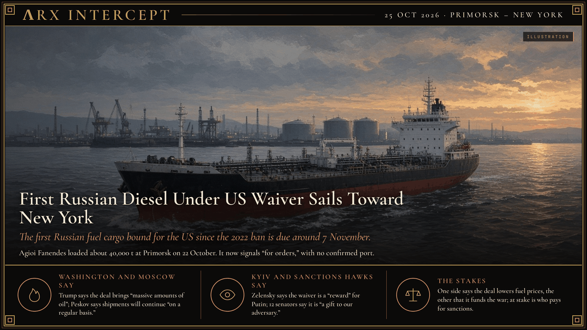

**ΛRX INTERCEPT** · Dispatch · 25 Oct 2026 · Primorsk

# First Russian Diesel Under US Waiver Sails Toward New York

*The first Russian fuel cargo bound for the US since the 2022 ban is due around 7 November.*

The first Russian diesel bound for the US since 2022 is crossing the Atlantic.

Trump's Oct. 9 waiver opened the door. The Kremlin says more tankers will follow. Zelensky calls it a reward for Putin.

The tanker now lists no port. Its New York arrival lands after the midterms.

The Malta-flagged tanker Agioi Fanendes loaded about 40,000 metric tons of ultra-low-sulfur diesel at Russia's Baltic port of Primorsk on 22 October and first signaled New York, with arrival expected around 6–7 November, according to LSEG, Kpler and S&P Global data. By 23 October its declared destination had changed to "for orders," a designation that usually means no final port is confirmed; its manager, Greece-based Eastern Mediterranean Maritime, says the discharge port has not been confirmed. The buyer and seller are not known. If it docks in the US, Reuters reports, it will be the first Russian petroleum cargo imported since the 2022 ban, arriving four days after the 3 November midterms.

On 9 October Trump announced a deal with Vladimir Putin for Russia to export 300,000 tons of diesel in October, 500,000 in November and about 1 million tons a month after that. The same day, Treasury's Office of Foreign Assets Control issued General License 135, which authorizes the sale, delivery and import of Russian-origin diesel, including into the US, through 7 April 2027. Russia then partly lifted the diesel export ban it imposed in July after Ukrainian strikes on its refineries. This cargo is about 13% of the October target. A European trader told S&P Global that US-bound volumes would mostly displace cargoes that would otherwise go to Brazil.

Trump says the deal will bring "massive amounts of oil" as he works to bring down diesel prices before the midterms. Kremlin spokesman Dmitry Peskov says the first tanker has sailed and that shipments "will continue on a regular basis." Ukrainian President Volodymyr Zelensky says the sanctions pause is a "reward" for Putin and "the first step" toward lifting more sanctions. Twelve senators from both parties, including Thom Tillis, Mitch McConnell and Richard Blumenthal, say the deal is "a gift to our adversary" and ask Trump to rescind the license and enforce the sanctions law he signed in September. We found no report that Trump discussed the Russian diesel deal at his Port Huron rally on 25 October.

One side says Russian diesel lowers prices at American pumps; the other says it pays for Russia's war in Ukraine. Beneath both is a question of leverage: who bears the cost of sanctions, and who decides when they are worth paying.

---

## Sources

**Original reporting**
- [Exclusive: First Russian diesel from Putin-Trump deal heading for US, data shows](https://www.investing.com/news/economic-indicators/exclusivetanker-carrying-40000-t-of-russian-diesel-heads-to-new-york-after-putintrump-deal-data-shows-4968099) — Reuters (via Investing.com)
- [Russian diesel tanker shipment to the US](https://apnews.com/article/russia-united-states-tanker-diesel-shipment-f2c733604fd4fbd82e7b668c94fad978) — AP
- [Russian Diesel Shipment Signals U.S. Destination After Trump Suspends Sanctions](https://www.wsj.com/finance/commodities-futures/tanker-carrying-russian-diesel-signals-u-s-port-after-trump-putin-deal-c09c15dd) — Wall Street Journal
- [Russian diesel tanker heads to New York as Kremlin claims regular shipments](https://www.spglobal.com/energy/en/news-research/latest-news/refined-products/102326-russian-diesel-tanker-heads-to-new-york-as-kremlin-claims-regular-shipments) — S&P Global

**Context**
- [Trump strikes deal with Putin to get diesel in sharp reversal of US policy weeks before midterms](https://apnews.com/article/trump-russia-diesel-midterms-12baccc7aade559bf329079b0548c9da) — AP

**Framing**
- [Trump's pause on Russia sanctions is 'reward' for Putin, Zelenskyy says](https://www.theguardian.com/world/2026/oct/17/volodymyr-zelenskyy-donald-trump-lift-sanctions-russia-intensify-war-ukraine) — The Guardian
- [Bipartisan Senators Call on Trump to Rescind Russian Diesel Deal](https://www.blumenthal.senate.gov/newsroom/press/release/bipartisan-senators-call-on-trump-to-rescind-russian-diesel-deal-and-implement-sanctions-authorized-by-congress-last-month-on-enablers-of-putins-war-against-ukraine) — Office of Sen. Richard Blumenthal

*Filed by the ΛRX Intercept desk · arxcortex.io*

*Grok Bot wrote this from the sources above, with human review before publishing.*
