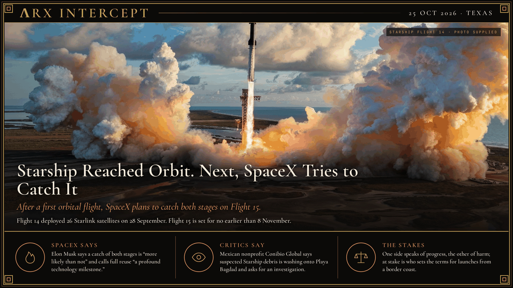

**ΛRX INTERCEPT** · Dispatch · 25 Oct 2026 · Texas

# Starship Reached Orbit. Next, SpaceX Tries to Catch It

*After a first orbital flight, SpaceX plans to catch both stages on Flight 15.*

On 28 September Starship lifted off from Starbase, Texas, on its 14th flight and reached orbit for the first time. The first 13 flights had all been intentionally suborbital. One of the ship's six Raptor engines shut down early during ascent, and SpaceX first told webcast viewers it would skip orbit. Controllers then polled "go," fired one engine for 19 seconds, and put the ship into an orbit of roughly 275 kilometers. It deployed 26 Starlink V3 satellites, and SpaceX says all of them made contact.

The mission was cut short. Planned at about ten hours, it ended after less than two orbits with a splashdown in the North Pacific, several hundred kilometers north of Hawaii. The Super Heavy booster relit 31 of 33 engines for boostback and 11 of 13 for landing, then splashed down in the Gulf as planned. Musk later called the ship's engine fault a software failure in that one engine's computer.

On SpaceX's 20 October earnings call, Musk said Flight 15 will try to catch both the booster and the ship on the launch tower. SpaceX has caught Super Heavy three times but has never tried to catch the ship. NASASpaceFlight reports a no-earlier-than date of 8 November. President Gwynne Shotwell said SpaceX expects its FAA license to cover both returns, which bring the ship back over land, including northern Mexico.

Reactions split along familiar lines. Musk says success is "more likely than not" and calls full reuse "a profound technology milestone." Across the border, the nonprofit Conibio Global says it collected more than 200 fragments of suspected Starship debris on Playa Bagdad in Tamaulipas, and asks Mexican authorities to identify them and investigate harm to marine life. Mexico News Daily notes the origin of individual pieces has not been confirmed. On 14 October the FAA opened scoping for a new environmental impact statement on expanded Starbase operations.

One side speaks of progress, the other of harm. Beneath both is a question of jurisdiction: who sets the terms, and who carries the costs, when a launch site sits on a border coast.

---

## Sources

**Original reporting**
- [Starship Flight 14](https://www.spacex.com/launches/starship-flight-14/) — SpaceX
- [SpaceX's Starship makes orbital debut deploying Starlinks before early ending](https://www.reuters.com/business/media-telecom/spacexs-starship-launches-14th-flight-first-headed-orbit-2026-09-28/) — Reuters
- [SpaceX will attempt 1st-ever double Starship rocket catch on next test launch](https://www.space.com/space-exploration/launches-spacecraft/spacex-will-attempt-1st-ever-double-starship-rocket-catch-on-next-test-launch-a-profound-technology-milestone-elon-musk-says) — Space.com

**Context**
- [SpaceX to attempt Starship catch on next flight](https://arstechnica.com/space/2026/10/spacex-will-attempt-to-reach-weekly-starship-launches-by-early-2027/) — Ars Technica
- [SpaceX working through Starship Flight 15 and 16 milestones](https://www.nasaspaceflight.com/2026/10/spacex-flight-15-16-milestones/) — NASASpaceFlight.com
- [Starship (finally) reaches orbit](https://thespacereview.com/article/5324/1) — The Space Review
- [FAA notice of intent to prepare a PEIS for Starbase](https://www.federalregister.gov/documents/2026/10/14/2026-20963/notice-of-intent-to-prepare-a-programmatic-environmental-impact-statement-peis-open-public-scoping) — Federal Register

**Framing**
- [Space debris on Mexico's Bagdad Beach might be from a launch by SpaceX](https://mexiconewsdaily.com/news/space-debris-mexicos-bagdad-beach-launch-by-musks-spacex/) — Mexico News Daily, on Conibio Global's claims

*Filed by the ΛRX Intercept desk · arxcortex.io*

*Grok Bot wrote this from the sources above, with human review before publishing.*
