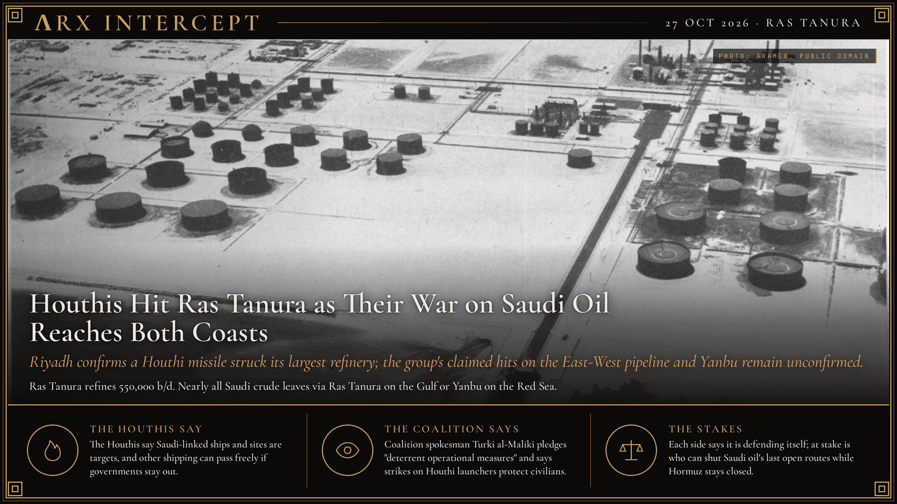

**ΛRX INTERCEPT** · Dispatch · 27 Oct 2026 · Ras Tanura

# Houthis Hit Ras Tanura as Their War on Saudi Oil Reaches Both Coasts

*Riyadh confirms a Houthi missile struck its largest refinery; the group's claimed hits on the East-West pipeline and Yanbu remain unconfirmed.*

A Houthi missile hit Ras Tanura, Saudi Arabia's largest refinery, on 27 October, and Riyadh confirmed it.

The Houthis also claim hits on the East-West pipeline and Yanbu, so far unconfirmed.

If those hold, both Saudi export coasts are under fire.

The Houthis have used Saudi oil as a pressure point for years. They claimed the September 2019 drone and missile strike on Aramco's Abqaiq and Khurais plants, which briefly knocked out about half of Saudi output; Washington blamed Iran. In March 2022 they hit an Aramco fuel depot in Jeddah. A UN-brokered truce in April 2022 largely ended the cross-border war that Saudi Arabia had joined in 2015, a year after the Houthis took Sanaa.

From November 2023 the Houthis turned on Red Sea shipping, attacking more than 100 merchant ships in what they called solidarity with Gaza and forcing much of the Asia-Europe trade around Africa. US and British strikes began in January 2024, and a heavier US air campaign ran from March to May 2025, when Oman brokered a US-Houthi ceasefire that left other ships uncovered. In July 2025 the Houthis sank the bulk carriers Magic Seas and Eternity C.

The Iran war, which began on 28 February 2026, changed the map. With the Strait of Hormuz largely shut, Saudi Arabia leaned on its 1,200-km East-West pipeline to Yanbu on the Red Sea. On 20 July the Houthis declared an embargo on Saudi-linked shipping. EU naval force Aspides and the conflict monitor ACLED count about 10 ships attacked through 24 August, mostly tankers; one vessel sank on 4 August, and on 11 August a strike on the Tihama in the Bab el-Mandeb killed four crew. In September Riyadh shut the East-West pipeline for a time after a drone attack that Saudi and Iraqi officials said came from Iraq.

On land, the Houthis took the port of Mocha in September and reached Perim Island in the Bab el-Mandeb on 11 September, ending the 2022 truce in practice. In October a Houthi missile hit King Khalid International Airport in Riyadh and killed 13 people, the deadliest attack in the kingdom in more than a decade, and Saudi jets struck Sanaa's airport. Saudi-backed government forces pushed the Houthis off parts of the coast earlier this month. On 24 October the Houthis claimed strikes on the East-West pipeline, an Aramco site in Yanbu and the Rabigh refinery; on 26 October they claimed the pipeline's pumping stations and Riyadh airport. Riyadh has confirmed none of those claims.

On 27 October Houthi spokesman Yahya Saree said a ballistic missile set fire to the Ras Tanura complex, a 550,000-barrel-a-day refinery and export terminal on the Gulf. Saudi Civil Defence confirmed the attack and reported "material damage" in Riyadh from intercepted missiles, and Bloomberg reported a fire near the terminal was contained. The Houthis also claimed attacks on military jets at Najran and Khamis Mushait, which Riyadh has not confirmed.

The Houthis say they target ships and sites they call Saudi-linked, and that other shipping can transit freely if governments stay out of the conflict. Coalition spokesman Turki al-Maliki says the coalition destroyed missile tunnels and launchers in Yemen and pledges continued "deterrent operational measures" to protect civilians.

The Houthis say they are answering Saudi strikes and Saudi-backed advances; Riyadh says it is protecting civilians from Houthi missiles. Underneath is control of the two routes Saudi crude still has, the Gulf terminals and the Red Sea pipeline, while Hormuz stays shut.

---

## Sources

**Original reporting**
- [Houthi missiles hit Saudi's largest oil refinery, Riyadh confirms material damage](https://www.indiatoday.in/amp/world/story/yemens-houthis-hit-saudi-oil-refinery-with-missile-riyadh-confirms-target-was-direct-3026347-2026-10-27) — India Today (Reuters)
- [Houthis say they attacked Saudi oil pumping stations, Riyadh airport as fighting intensifies](https://www.al-monitor.com/originals/2026/10/houthis-say-they-attacked-saudi-oil-pumping-stations-riyadh-airport-fighting) — Al-Monitor (Reuters)
- [EUNAVFOR Aspides informational message to the shipping industry](https://mscio.eu/media/documents/20260821-EUNAVFOR_ASPIDES_Informational_Message_to_the_Shipping_Industry.pdf) — EUNAVFOR Aspides
- [Houthis seize key Yemeni port of Mocha in drive to take control of Red Sea coast](https://www.theguardian.com/world/2026/sep/10/houthis-seize-key-port-mocha-yemen-red-sea-coast-iran-saudi-arabia-us) — The Guardian
- [As Houthis undercut Saudi security, a cautious kingdom pivots](https://www.csmonitor.com/World/Middle-East/2026/1013/saudi-security-houthi-airport-attacks-iran-yemen) — Christian Science Monitor

**Context**
- [Houthi gains around Bab al-Mandab raise risks to Red Sea shipping and global oil markets](https://acleddata.com/report/houthi-gains-around-bab-al-mandab-raise-risks-red-sea-shipping-and-global-oil-markets) — ACLED
- [Houthi blitz leaves Saudi Arabia exposed, Iran emboldened](https://www.reuters.com/world/middle-east/houthi-blitz-leaves-saudi-arabia-exposed-iran-emboldened-2026-09-16/) — Reuters
- [Houthi attacks on commercial shipping](https://en.wikipedia.org/wiki/Houthi_attacks_on_commercial_shipping) — Wikipedia
- [Abqaiq–Khurais attack](https://en.wikipedia.org/wiki/Abqaiq%E2%80%93Khurais_attack) — Wikipedia

*Filed by the ΛRX Intercept desk · arxcortex.io*

*Written from the sources above. Photo: Arabian American Oil Co. (Aramco), Ras Tanura refinery, Wikimedia Commons (public domain).*
