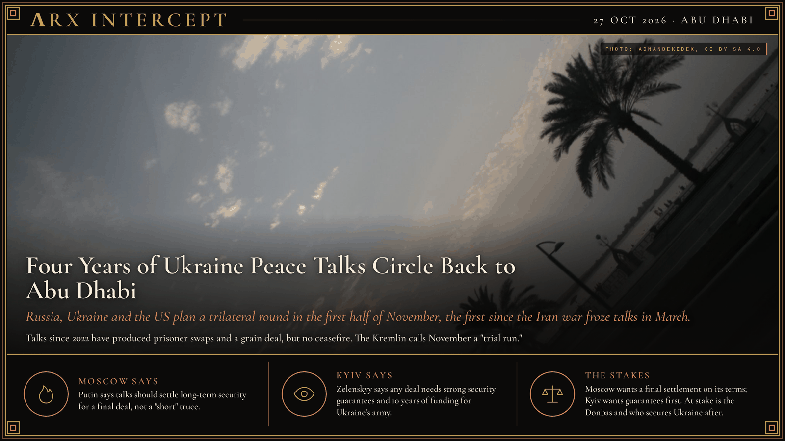

**ΛRX INTERCEPT** · Dispatch · 27 Oct 2026 · Abu Dhabi

# Four Years of Ukraine Peace Talks Circle Back to Abu Dhabi

*Russia, Ukraine and the US plan a trilateral round in the first half of November, the first since the Iran war froze talks in March.*

Russia, Ukraine and the US plan to meet in Abu Dhabi in the first half of November, the first round since the Iran war froze talks in March.

Since 2022 they have tried Belarus, Istanbul, Riyadh, Alaska and Geneva. Moscow still wants all of Donbas.

Russian and Ukrainian delegations first met on 28 February 2022, four days into the full-scale invasion, on the Belarusian border. By 29 March in Istanbul, Kyiv had tabled a draft offering neutrality in exchange for international security guarantees. The talks faded in April after the discovery of killings of civilians in Bucha and as each side's battlefield prospects shifted. The one durable deal of that year came in July 2022, when Turkey and the UN brokered the Black Sea Grain Initiative; Russia quit it in July 2023. Prisoner exchanges, often mediated by the UAE and Turkey, continued throughout.

Direct diplomacy returned with Donald Trump. US and Russian officials met in Riyadh in February 2025 without Ukraine, and in Jeddah on 11 March Ukraine accepted a US proposal for a 30-day ceasefire, which Moscow did not accept. Russia and Ukraine met directly in Istanbul on 16 May 2025 for the first time since 2022, and again in June and July; the rounds produced the war's largest prisoner swaps but no truce. Trump met Vladimir Putin in Anchorage, Alaska, on 15 August 2025 without an agreement. In November a US 28-point plan went through revisions with Kyiv in Geneva, and envoy Steve Witkoff took the revised plan to Putin in Moscow on 2 December.

The first three-way rounds came in Abu Dhabi on 23 and 24 January and 4 and 5 February 2026, led on the US side by Witkoff and Jared Kushner. Russia demanded the roughly 20% of Donetsk region it does not hold; the only concrete result was a swap of 157 prisoners each way. A Geneva round on 17 and 18 February ended with both sides calling it "difficult." The next round, planned for 5 to 9 March in Abu Dhabi, was postponed after the US-Israeli war on Iran began on 28 February and Iranian strikes hit the Gulf.

Talks stayed frozen for seven months. Witkoff and Kushner met President Volodymyr Zelenskyy and European leaders on 20 October and Putin in St Petersburg on 21 October. Kremlin spokesman Dmitry Peskov said on 23 October that the next round is "planned for the first half of November in Abu Dhabi" in a trilateral format, and Putin aide Yuri Ushakov said Moscow will be ready after its 4 November holiday, calling the first meeting a "trial run." In the meantime Washington has eased sanctions on Russian oil and agreed to buy 300,000 tonnes of Russian diesel, which European leaders say gives Moscow "hope." Ukraine's prosecutor general's office says Russian attacks have killed more than 19,000 Ukrainian civilians since February 2022.

Putin says any trilateral talks should settle long-term security arrangements for a final peace deal, not a "short" truce, and Moscow still demands the rest of Donbas and an end to Ukraine's NATO bid. Zelenskyy says technical talks should start "as early as possible," that any deal needs strong security guarantees and funding for Ukraine's army for 10 years, and that Europe should take part. Kyiv has accepted several US ceasefire proposals that Moscow has rejected.

Moscow says peace means a settlement that removes the war's causes as it defines them; Kyiv says peace means a ceasefire backed by guarantees that stop a new invasion. Underneath both is the same ground: who holds the rest of Donbas, and who, if anyone, stands behind Ukraine once the shooting stops.

---

## Sources

**Original reporting**
- [Russia and Ukraine say talks planned for November in UAE](https://www.aljazeera.com/news/2026/10/23/russia-ukraine-talks-planned-for-november-in-uae-kremlin) — Al Jazeera
- [Moscow ready to resume trilateral talks with Ukraine, US after Nov. 4, Kremlin aide says](https://kyivindependent.com/moscow-ready-to-resume-trilateral-talks-with-ukraine-us-after-nov-4-kremlin-aide-says/) — Kyiv Independent
- [Russia and Ukraine exchange prisoners as peace talks end without breakthrough](https://www.bbc.com/news/articles/c62np09q7l1o) — BBC News
- [No breakthrough on bridging gaps in Russia-Ukraine talks](https://apnews.com/article/russia-ukraine-war-talks-geneva-0f22fa796cafd6606a88ad1b101ab3fb) — AP News
- [U.S., Ukraine discussed postponing peace talks with Russia, Zelenskiy says](https://www.reuters.com/world/europe/ukraine-seeks-postpone-next-round-trilateral-talks-with-russia-amid-middle-east-2026-03-05/) — Reuters

**Context**
- [2026 United States–Ukraine–Russia meetings in Abu Dhabi](https://en.wikipedia.org/wiki/2026_United_States%E2%80%93Ukraine%E2%80%93Russia_meetings_in_Abu_Dhabi) — Wikipedia
- [Peace negotiations in the Russian invasion of Ukraine](https://en.wikipedia.org/wiki/Peace_negotiations_in_the_Russian_invasion_of_Ukraine) — Wikipedia
- [Black Sea Grain Initiative](https://en.wikipedia.org/wiki/Black_Sea_Grain_Initiative) — Wikipedia
- [2025 Russia–United States summit](https://en.wikipedia.org/wiki/2025_Russia%E2%80%93United_States_summit) — Wikipedia

*Filed by the ΛRX Intercept desk · arxcortex.io*

*Written from the sources above. Photo: AdnanDekedek, Abu Dhabi Corniche skyline, Wikimedia Commons (CC BY-SA 4.0).*
