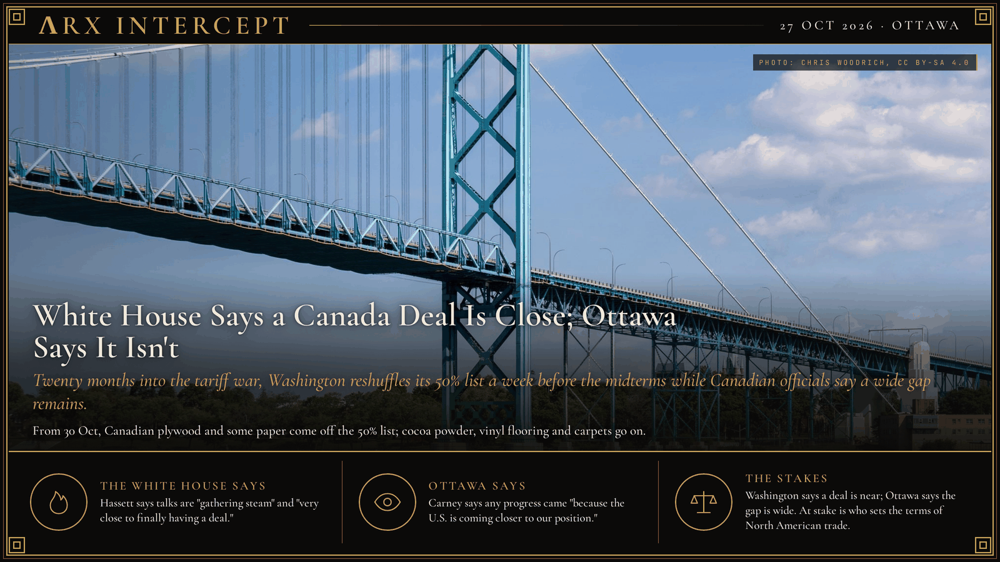

**ΛRX INTERCEPT** · Dispatch · 27 Oct 2026 · Ottawa

# White House Says a Canada Deal Is Close; Ottawa Says It Isn't

*Twenty months into the tariff war, Washington reshuffles its 50% list a week before the midterms while Canadian officials say a wide gap remains.*

Kevin Hassett says a US-Canada trade deal is very close. Ottawa says it is not on the verge.

A week before the midterms, the White House swapped goods on its 50% tariff list, a move Bloomberg reads as help for Susan Collins in Maine.

The fight began in February 2025, when President Donald Trump invoked emergency powers to put 25% tariffs on Canadian goods, citing fentanyl and the border; they took effect on 4 March, with energy at 10%, and goods that met USMCA rules were soon exempted. Separate national-security tariffs followed: 25% on cars in April, and steel and aluminum rising to 50% in June. Ottawa answered with counter-tariffs, and Ontario pulled American liquor from its shelves. In August 2025 the emergency rate on non-USMCA goods rose to 35%. Canada dropped most of its counter-tariffs that September, and in October Trump broke off talks over an Ontario television ad quoting Ronald Reagan on tariffs.

On 20 February 2026 the US Supreme Court ruled in Learning Resources v. Trump that the emergency-powers law does not authorize tariffs, and collection of the 35% duty ended on 24 February. The steel, aluminum and auto tariffs stayed. Talks on a broader deal ran through the summer and collapsed on 21 August, with each side blaming the other; Prime Minister Mark Carney said last-minute US changes were unacceptable and suspended negotiations. The next day Washington put a 50% tariff on what Carney put at roughly $28 billion of Canadian goods, and Canada matched it dollar for dollar with counter-tariffs on about 700 US products from 8 September.

In September Trump exempted road salt and other goods after a request from Republican Senator Susan Collins of Maine. On 23 October the White House reshuffled the 50% list, effective 30 October: some plywood, bleached coated paperboard, cartons, packaging, seaweed and farm and refrigeration machinery come off, and cocoa powder products, vinyl flooring, carpets, personal-care products and other goods go on. Politico reported that the total value of goods tariffed stays the same. Bloomberg reported that the White House described the change as an effort to help Collins keep her seat, and Hassett said "President Trump has put the citizens of Maine first." Her Democratic opponent, Troy Jackson, says Collins "wants credit for bringing a cup of water to put out the fire."

National Economic Council director Kevin Hassett said on 25 October that the 19 October Alberta referendum, in which 74.9% voted to stay in Canada, had slowed talks, and that negotiations have since "picked up" and are "very close to finally having a deal." Trump told a rally in Port Huron, Michigan, that Canada is "willing to give us anything at this moment." A Canadian source told Radio-Canada, "We are not on the verge of an agreement just yet," and chief negotiator Janice Charette said last week that "pens are down, and the doors are open." A US official told Bloomberg that Washington does not think Canada is offering enough yet.

Hassett says talks are "gathering steam" and a deal is "very close." Carney says Canada has "very clear bottom lines, red lines" and that "to the extent any progress has been made, it's because the U.S. is coming closer to our position." Ontario Premier Doug Ford says the trade fight "is affecting" Trump before the vote.

The White House says a deal is close and that it is putting Maine first; Ottawa says it will sign only a deal in Canada's interest and that the US is the side moving. Underneath both is leverage: whether tariffs set before an election can force Canada to accept US terms, or whether the election forces Washington to soften them.

---

## Sources

**Original reporting**
- [Hassett says U.S.-Canada trade talks are 'very close' to deal](https://financialpost.com/news/economy/hassett-us-canada-trade-talks-very-close) — Financial Post (Bloomberg)
- [Canada-U.S. trade talks intensifying but wide gap remains, sources say](https://www.cbc.ca/news/politics/trade-talks-intensifying-no-deal-in-sight-9.7396332) — CBC News
- [Annex I: Products no longer covered / newly covered by Section 338 tariffs](https://www.whitehouse.gov/wp-content/uploads/2026/10/2026ModifyingAuto338.prc_.AnnexI-3.pdf) — The White House
- [Trump to lower Canada tariffs for certain agricultural goods, Collins says](https://www.politico.com/news/2026/10/23/collins-trump-canada-tariffs-maine-agriculture-01134028) — Politico
- [US hits Canadian goods with 50% tariffs after trade talks fail](https://www.reuters.com/world/americas/us-canadian-trade-teams-meet-again-tariffs-deadline-looms-2026-08-21/) — Reuters
- [Canada slaps retaliatory tariffs on US goods worth $20 billion as trade war intensifies](https://www.reuters.com/business/canada-announces-20-bln-retaliatory-tariffs-us-goods-unveils-support-measures-2026-08-25/) — Reuters

**Context**
- [U.S.–Canada tariffs: timeline of key dates and documents](https://www.blakes.com/insights/us-canada-tariffs-timeline-of-key-dates-and-documents/) — Blakes
- [Learning Resources, Inc. v. Trump, No. 24-1287 (20 February 2026)](https://www.supremecourt.gov/opinions/25pdf/24-1287_4gcj.pdf) — Supreme Court of the United States
- [Alberta's referendum count is finished, and 74.9 per cent of voters want to stay in Canada](https://thecanadabrief.com/p/1371-alberta-s-referendum-count-is-finished-and-74-9-per-cent-of) — The Canada Brief

**Framing**
- [Statement by Prime Minister Carney on Canada-U.S. trade negotiations](https://www.pm.gc.ca/en/news/statements/2026/08/21/statement-prime-minister-carney-canada-us-trade-negotiations) — Prime Minister of Canada
- [Trump adviser says Alberta referendum made it essentially impossible to negotiate](https://www.cp24.com/news/canada/2026/10/26/trump-adviser-says-alberta-referendum-made-it-essentially-impossible-to-negotiate-on-trade-deal/) — CP24

*Filed by the ΛRX Intercept desk · arxcortex.io*

*Written from the sources above. Photo: Chris Woodrich, the Ambassador Bridge from the Detroit River, Wikimedia Commons (CC BY-SA 4.0).*
