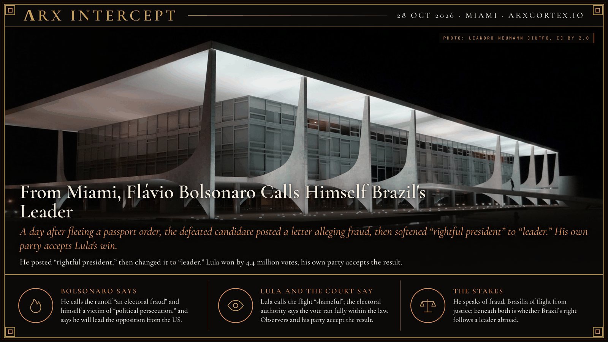

**ΛRX INTERCEPT** · Dispatch · 28 Oct 2026 · Miami

# From Miami, Flávio Bolsonaro Calls Himself Brazil's Leader

*A day after fleeing a passport order, the defeated candidate posted a letter alleging fraud, then softened "rightful president" to "leader." His own party accepts Lula's win.*

Hours after landing in Miami, Flávio Bolsonaro posted a letter calling himself Brazil's "rightful president," then deleted it and wrote "leader." He alleges fraud without evidence; Lula won by 4.4 million votes and his own party accepts the result.

Flávio Bolsonaro landed at Miami-Opa Locka airport with his wife and two daughters at 9:24 a.m. on Wednesday, 28 October, after crossing from Brazil into Argentina and flying via Ecuador, as [our earlier dispatch](https://arxcortex.github.io/arxstories/dispatches/2026-10-28-flavio-bolsonaro-defies-passport-order-lands-in-miami/) reported. He left in defiance of a Supreme Court order to surrender his passports, issued in a money-laundering investigation. He has not been charged and denies wrongdoing.

About seven hours after landing, he posted a letter on X. The first version, later deleted, began: "I address the Brazilian people and the international community as the rightful president of Brazil," according to the BBC. Agência Brasil reports the wording was changed about half an hour later to "leader of Brazil." The Guardian counted at least three versions published by him and his allies. Reuters reports that he described himself as the victim of an electoral coup by President Luiz Inácio Lula da Silva and the Supreme Court.

The letter repeats, without evidence, his election-night claim that a two-hour extension of polling hours was "an electoral fraud unfolding before my eyes." Both campaigns had asked for the extension. BBC Brazil and BBC Verify found about 34,000 people voted in the extra hours; Lula won the 25 October runoff by 4.4 million votes. The head of the electoral authority says the vote ran in full accordance with the law, and the Organization of American States recognised the result, Agência Brasil reports.

He thanked Argentine President Javier Milei "for his courage, sense of justice and legality," and Donald Trump "and the wonderful American people for welcoming me." The Trump administration approved visas for him and his family but has not said what kind. Asked about his claim, Trump said: "I won't get involved. It was a very strange election, that's for sure." The letter says he will lead the opposition from the US and ends: "I left Brazil but I haven't abandoned Brazilians."

His camp has not followed. His Liberal Party said on Monday it recognises the result, and his campaign manager, Rogério Marinho, said on Wednesday there is "no evidence" of fraud. Reuters reports the claim has failed to win support from key figures on the right. Folha de S.Paulo, O Globo and O Estado de S. Paulo all called the declaration "coup-mongering," The Guardian reports. Lula called the flight "shameful" and said the family's "first homeland is licking the boots of the US."

Bolsonaro speaks of fraud and persecution, Brasília of a man fleeing an investigation; beneath both is whether Brazil's right follows a leader who now speaks from Florida, with Washington's visa but not its endorsement.

---

## Sources

**Original reporting**
- [Flávio Bolsonaro calls himself 'leader of Brazil' after election loss](https://www.bbc.com/news/articles/c3x2w4109pj8o) — BBC News
- [Flávio Bolsonaro calls himself the 'leader of Brazil' after fleeing to Miami](https://www.theguardian.com/world/2026/oct/28/flavio-bolsonaro-miami-us-fleeing-brazilian-election-defeat) — The Guardian
- [Flavio Bolsonaro lands in Miami, declares himself rightful leader of Brazil](https://www.scmp.com/news/world/united-states-canada/article/3372478/defeated-brazilian-presidential-candidate-flavio-bolsonaro-and-his-family-land-miami) — South China Morning Post (Reuters)
- [Coup-mongering letter: Flávio Bolsonaro thanks Trump, Milei for aid](https://agenciabrasil.ebc.com.br/en/politica/noticia/2026-10/flavio-bolsonaro-thanks-trump-milei-aid-coup-mongering-letter) — Agência Brasil

**Context**
- [Defeated Brazilian presidential candidate Flávio Bolsonaro and his family arrive in Miami](https://apnews.com/article/brazil-election-flavio-bolsonaro-ecuador-argentina-9fc1f409ed993403736dbae07bd74bd8) — AP
- [Reuters World News Summary](https://www.devdiscourse.com/article/international/3999256-reuters-world-news-summary) — Devdiscourse (Reuters)
- [Flávio Bolsonaro Defies a Passport Order and Lands in Miami](https://arxcortex.github.io/arxstories/dispatches/2026-10-28-flavio-bolsonaro-defies-passport-order-lands-in-miami/) — ΛRX Intercept

**Framing**

*Filed by the ΛRX Intercept desk · arxcortex.io*

*Written from the sources above. Photo: Leandro Neumann Ciuffo, Palácio do Planalto, Brasília, Wikimedia Commons (CC BY 2.0).*
