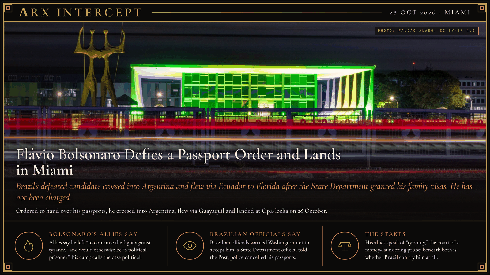

**ΛRX INTERCEPT** · Dispatch · 28 Oct 2026 · Miami

# Flávio Bolsonaro Defies a Passport Order and Lands in Miami

*Brazil's defeated candidate crossed into Argentina and flew via Ecuador to Florida after the State Department granted his family visas. He has not been charged.*

Brazil's Supreme Court ordered Flávio Bolsonaro to hand over his passports. He crossed into Argentina instead, flew via Guayaquil and landed near Miami after the State Department granted his family visas. He has not been charged and denies wrongdoing.

On Monday, 26 October, Supreme Court Justice Alexandre de Moraes cancelled Bolsonaro's Brazilian passports, regular and diplomatic, and gave him 24 hours to hand over any foreign ones, in an investigation into alleged money laundering. The Washington Post reports the probe concerns his financial ties to a banker accused of misconduct and to a man suspected of laundering money through Brazil's betting industry. He had said he would stay in Brazil to lead the opposition to President Luiz Inácio Lula da Silva, who beat him in Sunday's runoff ([our 25 Oct dispatch](../2026-10-25-lula-wins-runoff-flavio-seeks-annulment/)). The deadline passed at noon on Tuesday, and the Federal Police cancelled the documents.

Argentina's migration agency says Bolsonaro, his wife and two daughters crossed the Tancredo Neves bridge into Argentina at 10:50 p.m. on 27 October "without any legal impediment," and boarded a private flight to Guayaquil, Ecuador, 40 minutes later. CNN Brasil, citing a police source, reports he entered Argentina on his Italian passport; he has held Italian citizenship since 2023, according to the Italian government. Flight data cited by Agenzia Nova show the same Gulfstream landing at Miami-Opa Locka Executive Airport on Wednesday morning. CNN Brasil reports he entered the United States on his cancelled Brazilian diplomatic passport.

A senior State Department official told the Post that the United States granted Bolsonaro and his family visas. Asked about his whereabouts, Trump said: "I heard he was in Argentina." Bolsonaro has not been charged and denies the allegations. If he is charged and convicted, the crime would fall under the US-Brazil extradition treaty, a State Department official told the Post. His father, former President Jair Bolsonaro, also flew to Florida after losing to Lula in 2022.

A Bolsonaro ally in Texas told the Post that he "had to leave to continue the fight against tyranny. Or else he'd be a political prisoner," and the Bolsonaro camp says it sees the case as political persecution. Brazilian officials tried to warn Washington not to accept him, a State Department official told the Post. Moraes's office did not respond to the Post's request for comment.

His allies speak of "tyranny" and the court of a money-laundering probe; beneath both is whether a Brazilian court can bring the opposition's leader to trial, and whether Washington will hand him back if it does.

---

## Sources

**Original reporting**
- [Defeated presidential candidate Flávio Bolsonaro and his family land in Miami after fleeing Brazil](https://apnews.com/article/brazil-election-flavio-bolsonaro-ecuador-argentina-9fc1f409ed993403736dbae07bd74bd8) — AP
- [Bolsonaro is granted a U.S. visa after fleeing Brazil following election loss](https://www.washingtonpost.com/world/2026/10/27/flvio-bolsonaro-fails-turn-passports-brazilians-question-his-whereabouts/) — The Washington Post
- [Confusion about Flávio Bolsonaro's whereabouts after Brazil cancels his passports](https://www.bbc.com/news/articles/ckly0xpxp243o) — BBC News
- [Como Flávio entrou na Argentina e nos EUA? Veja quais passaportes ele usou](https://www.cnnbrasil.com.br/politica/como-flavio-entrou-na-argentina-e-nos-eua-veja-quais-passaportes-ele-usou/) — CNN Brasil

**Context**
- [Migraciones confirmó que Flávio Bolsonaro viajó con su familia desde Argentina hacia Ecuador](https://www.apfdigital.com.ar/noticias/2026/10/28/476661-migraciones-confirmo-que-flavio-bolsonaro-viajo-con-su-familia-desde-argentina-hacia-ecuador-sin-ningun-impedimento-legal) — APFDigital
- [Flavio Bolsonaro landed in Miami, using his Italian passport to leave Brazil](https://www.agenzianova.com/en/news/Flavio-Bolsonaro-landed-in-Miami-to-leave-Brazil-using-his-Italian-passport./) — Agenzia Nova

**Framing**

*Filed by the ΛRX Intercept desk · arxcortex.io*

*Written from the sources above. Photo: Falcão Alado, Supreme Federal Court, Brasília, Wikimedia Commons (CC BY-SA 4.0).*
