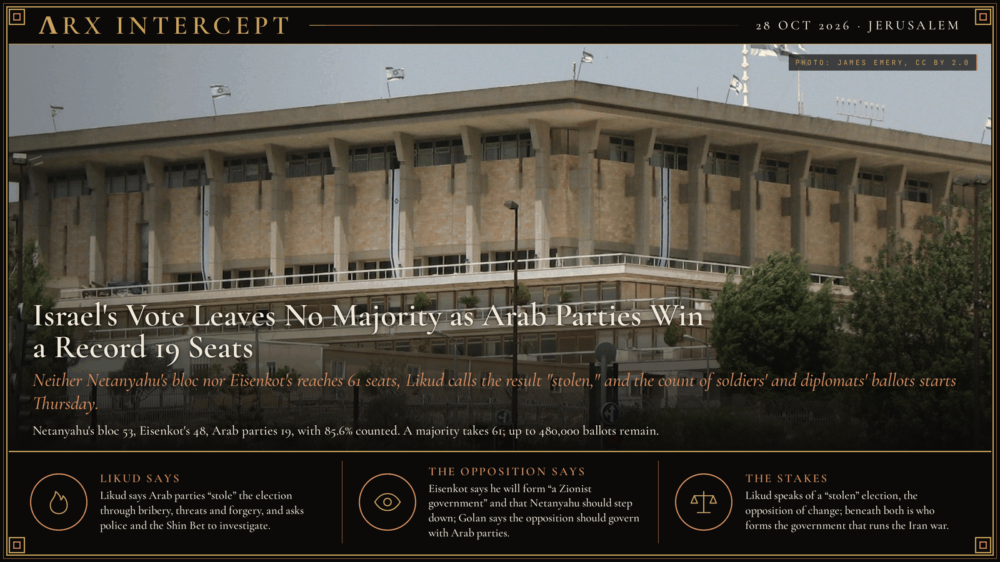

**ΛRX INTERCEPT** · Dispatch · 28 Oct 2026 · Jerusalem

# Israel's Vote Leaves No Majority as Arab Parties Win a Record 19 Seats

*Neither Netanyahu's bloc nor Eisenkot's reaches 61 seats, Likud calls the result "stolen," and the count of soldiers' and diplomats' ballots starts Thursday.*

Israel's election left no one a majority. With 85.6% counted, Netanyahu's bloc has 53 seats and Eisenkot's 48, short of the 61 needed. Arab parties won a record 19. Up to 480,000 soldier and diplomat ballots remain, and Likud calls the vote "stolen."

Israelis voted on Tuesday, 27 October, in the first national election since the 7 October 2023 attacks. Turnout at the close of polls was 77.7%, up from 70.6% in 2022, according to The Times of Israel. With about 93% of ordinary ballots counted, 85.6% of the total, the Central Elections Committee gave Prime Minister Benjamin Netanyahu's bloc 53 seats and the Jewish-led opposition bloc led by Gadi Eisenkot's Yashar 48. The Arab-led parties won 19, a record: 12 for the Joint List and 7 for Ra'am, by Ynetnews' count. A majority in the 120-seat Knesset takes 61. Likud is the largest single party. Three lists, among them the Reservists and People of Israel, sit below the 3.25% threshold.

The committee says it will begin counting the "double-envelope" ballots of soldiers, police, diplomats and others at 1 a.m. on Thursday, and expects to finish by Thursday evening. It puts those ballots at up to 480,000. The Times of Israel writes that historical trends suggest they will shift seats but likely not the balance between the blocs.

The Arab parties oppose Netanyahu, but three of the four Jewish-led opposition parties have said they will not govern with them. Avigdor Liberman of Yisrael Beytenu says he will neither join a Netanyahu government nor back a minority government that relies on Arab parties, and Channel 12 reports that he wants Eisenkot to join a unity government with Netanyahu. Kan reports that opposition parties are weighing a move to replace Likud's Amir Ohana as Knesset speaker with Arab parties' support. President Isaac Herzog has urged the parties to avoid another election. Netanyahu stays on as caretaker prime minister, with his war powers intact, while talks go on.

Washington is watching because of Iran. US President Donald Trump took credit for Netanyahu's late gains after endorsing him, and Channel 12 reports Trump saying he and Netanyahu must "finish the job" against Iran, by a deal or other means. A US official told The Times of Israel that reports of a coalition Washington prefers are "false and premature."

Likud says the election was "stolen by Arab parties" through "bribery, threats, violence, forgeries and the use of illegal software to mobilize voters," and says it has given police, the Shin Bet and the committee "hundreds of testimonies." Ra'am rejects the accusations. The committee says it reviews fraud complaints from all parties in every election, and on election day it said it found no evidence of systematic tampering. Eisenkot says he will "do my utmost to form a Zionist government" and that Netanyahu should step down; Netanyahu says Israel needs a "strong, national, right-wing government." Yair Golan of The Democrats is the only opposition leader who says he would govern with Arab parties.

Likud speaks of a "stolen" election and Eisenkot of a "Zionist government"; beneath both is the question of who forms the government that decides whether Israel goes back to war with Iran. The 19 Arab seats decide whether the opposition can reach 61 without Likud.

---

## Sources

**Original reporting**
- [With over 85% of votes counted, pro-Netanyahu bloc gets 53 seats, Eisenkot-led bloc at 48 and Arab parties have 19](https://www.timesofisrael.com/liveblog_entry/with-over-85-of-votes-counted-pro-netanyahu-bloc-gets-53-seats-eisenkot-led-bloc-at-48-and-arab-parties-have-19/) — The Times of Israel
- [Live updates, October 28, 2026](https://www.timesofisrael.com/liveblog-october-28-2026/) — The Times of Israel
- [Israel election results live](https://www.theguardian.com/world/live/2026/oct/28/israel-election-results-live-updates-exit-polls-netanyahu-likud-eisenkot-latest-news) — The Guardian

**Context**
- [Turnout hits historic high as Israel votes; election committee rejects multiple claims of foul play](https://www.timesofisrael.com/turnout-hits-historic-high-as-israel-votes-in-national-election-parties-allege-foul-play/) — The Times of Israel
- [Elections panel says it is reviewing all fraud allegations after Likud demand for probe of Arab parties](https://www.timesofisrael.com/liveblog_entry/elections-panel-says-it-is-reviewing-all-fraud-allegations-after-likud-demand-for-probe-of-arab-parties/) — The Times of Israel

**Framing**
- [Likud claims election 'stolen' by Arab parties, demands investigation into alleged fraud](https://www.timesofisrael.com/liveblog_entry/likud-claims-election-stolen-by-arab-parties-demands-investigation-into-alleged-fraud/) — The Times of Israel
- [Netanyahu's Likud accuses Arab parties of election fraud, demands police probe](https://www.ynetnews.com/article/s1q6l51tmx) — Ynetnews

*Filed by the ΛRX Intercept desk · arxcortex.io*

*Written from the sources above. Photo: James Emery, the Knesset in Jerusalem, Wikimedia Commons (CC BY 2.0).*
