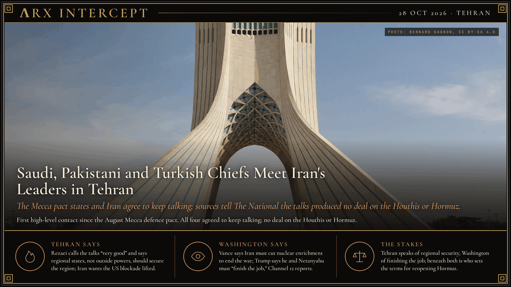

**ΛRX INTERCEPT** · Dispatch · 28 Oct 2026 · Tehran

# Saudi, Pakistani and Turkish Chiefs Meet Iran's Leaders in Tehran

*The Mecca pact states and Iran agree to keep talking; sources tell The National the talks produced no deal on the Houthis or Hormuz.*

Saudi Arabia's defence minister, Pakistan's army chief and Turkey's spy chief met Iran's leaders in Tehran on Monday, their first high-level contact since the August Mecca pact. All four agreed to keep talking. Sources told The National there was no deal.

Saudi Defence Minister Prince Khalid bin Salman, Pakistan's army chief Field Marshal Asim Munir and Turkish intelligence chief Ibrahim Kalin met Iran's Supreme National Security Council secretary Mohsen Rezaei in Tehran on Monday, 26 October, with President Masoud Pezeshkian and Foreign Minister Abbas Araghchi attending. Reuters reports it was the first high-level contact between Iran and the three states since they signed the Mecca mutual defence pact in August and since the war drew Saudi Arabia and Yemen's Houthis into direct conflict. According to Anadolu, the talks covered Palestine, Lebanon, Yemen, the Strait of Hormuz and US-Iran negotiations. In a joint statement carried by Press TV, the four "agreed to continue the dialogue."

Regional sources told The National the talks made no clear headway. The visitors asked Iran to get the Houthis to stop attacking Saudi Arabia; Iran said it lacked the leverage, the sources said. Iran in turn asked them to persuade Washington to accept a two-week regional pause in exchange for a gradual reopening of Hormuz. Hours later the Saudi-led coalition said it intercepted three ballistic missiles and four drones launched by the Houthis. A source close to Tehran told The National a second round, possibly in Turkey, has not been ruled out.

On Tuesday Rezaei met Supreme Leader Mojtaba Khamenei, who, state media said, stressed keeping Iran's conditions for ending the war. Those conditions include an end to the US blockade of Iranian ports and to US sanctions on its oil exports, Reuters reports. Iran's official said the nuclear programme was not on Monday's agenda. Separately, Channel 12 reports Qatar is floating a deal that would trade UN inspectors' access to bombed nuclear sites for some sanctions relief, with Pakistan, Saudi Arabia, Egypt and Turkey backing the effort.

Oman, which is not part of the current talks, pushed a wider idea the same day. Foreign Minister Badr Albusaidi called for a non-aggression pact among the six Gulf states, Iran and Iraq, and said outside partners' role in Gulf security "can no longer be primary." On Wednesday he told the BBC the United States should shift "from the military only to the more lucrative economic sphere."

Rezaei calls the talks "very good" and says countries of the region, not outside powers, should provide its security. US Vice President JD Vance said three weeks ago that Iran must reduce nuclear enrichment to end the war, and Channel 12 reports Trump saying he and Netanyahu must "finish the job" against Iran, by a deal or otherwise.

Tehran speaks of security run by the region and Washington of finishing the job; beneath both is who sets the terms for reopening Hormuz and lifting the blockade. The Mecca pact states sit between the two, and the Houthis are striking one of them.

---

## Sources

**Original reporting**
- [Iran, Saudi Arabia, Turkiye and Pakistan agree to continue talks for peace](https://www.aljazeera.com/news/2026/10/26/officials-from-mecca-pact-states-to-hold-talks-in-iran-amid-regional-tensions) — Al Jazeera
- [Iran security chief meets Supreme Leader after talks with Mecca pact countries](https://www.al-monitor.com/originals/2026/10/iran-security-chief-meets-supreme-leader-after-talks-mecca-pact-countries) — Al-Monitor (Reuters)
- [Inside Tehran talks: Iranians link Houthi de-escalation to US approval of regional truce](https://www.thenationalnews.com/news/gulf/2026/10/27/exclusive-iran-saudi-arabia-inside-tehran-talks/) — The National
- [Turkish intelligence chief holds talks in Iran with Saudi, Pakistani officials](https://aa.com.tr/en/world/turkish-intelligence-chief-holds-talks-in-iran-with-saudi-pakistani-officials/4101915) — Anadolu Agency
- [High-level delegations meeting in Tehran to avert more war](https://apnews.com/article/iran-israel-us-war-10-26-2026-36486edb61b3bf4e0df67e8a17123e44) — AP

**Context**
- [Minister calls on Gulf states to take responsibility for their own security](https://www.fm.gov.om/en/62242/) — Oman Ministry of Foreign Affairs
- [Middle East peace held back by US insistence that Iran is a threat, Oman's foreign minister says](https://www.theguardian.com/world/2026/oct/26/saudi-pakistani-turkish-delegation-iran-avert-flare-up-conflict-us) — The Guardian
- [Oman calls for economic and security pact between Iran and Gulf countries](https://www.thenationalnews.com/news/mena/2026/10/28/oman-calls-for-economic-and-security-pact-between-iran-and-gulf-countries/) — The National

**Framing**
- [Live updates, October 28, 2026](https://www.timesofisrael.com/liveblog-october-28-2026/) — The Times of Israel

*Filed by the ΛRX Intercept desk · arxcortex.io*

*Written from the sources above. Photo: Bernard Gagnon, Azadi Tower, Tehran, Wikimedia Commons (CC BY-SA 4.0).*
