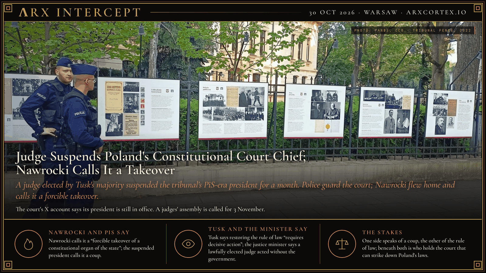

**ΛRX INTERCEPT** · Dispatch · 30 Oct 2026 · Warsaw

# Judge Suspends Poland's Constitutional Court Chief; Nawrocki Calls It a Takeover

*A judge elected by Tusk's majority suspended the tribunal's PiS-era president for a month. Police guard the court; Nawrocki flew home and calls it a forcible takeover.*

On Friday evening, Judge Anna Korwin-Piotrowska suspended Constitutional Tribunal president Bogdan Święczkowski and his deputy for a month and took charge of the court. President Karol Nawrocki turned his plane back from Senegal and says the court was taken by force; Prime Minister Donald Tusk says the rule of law is being restored.

At about 6 p.m. on Friday, 30 October, the tribunal's website announced that Korwin-Piotrowska, as the judge with the longest judicial service, now heads the court, and that she had ordered a one-month break in duties for Święczkowski and Vice-President Bartłomiej Sochański, Rzeczpospolita reports. Her order, quoted by Prawo.pl, counts her service from the start of her judicial training on 1 September 1995. It gives as grounds that Święczkowski barred five judges elected by the current Sejm, including her, from hearing cases, and that by keeping them out he left the court unable to adopt its 2027 budget. Korwin-Piotrowska told TVP Info a disciplinary court must now rule on the suspensions. The same day, Justice Minister and Prosecutor General Waldemar Żurek filed five requests to lift the immunity of the two judges, four against Święczkowski and one against Sochański, with 50 volumes of case files.

The tribunal's X account says he remains president and that Korwin-Piotrowska cannot lead the court because Nawrocki never swore her in, AFP reports. Święczkowski calls the move a coup d'état, Politico reports. Police say they deployed after warnings of threats to judges and staff and did not enter the building; three people were detained after climbing the court's fence. Law and Justice (PiS) leader Jarosław Kaczyński joined several hundred protesters outside and says Poland risks becoming a "police state."

Nawrocki, flying to Senegal for the opening of the Youth Olympic Games, ordered his plane back to Warsaw, AFP reports. He met the First President of the Supreme Court, Zbigniew Kapiński, and went with him to the tribunal shortly before 1 a.m. Video posted by Judge Maciej Berek shows the president pushing through a group of judges at the door; Berek says he ran into Korwin-Piotrowska, Onet reports. Żurek says the footage shows the president "forcing his way in and attacking the judges." Before 5 a.m., Nawrocki's chief of staff, Paweł Szefernaker, read a statement outside the court describing a "forcible takeover of a constitutional organ of the state." It demanded that the police sent by the government leave, and it called emergency talks with parliamentary parties, citing a threat to internal security.

Leaders of PSL, Poland 2050, PiS, Razem and Confederation met Nawrocki on Saturday; Tusk's Civic Coalition and the Left stayed away, Fakt reports. Confederation's Sławomir Mentzen says the terms of all 15 judges should be ended and a new bench appointed. Razem's Adrian Zandberg says he told Nawrocki he had stopped acting as an arbiter and become a party to the dispute. In a televised address on Saturday, Tusk said he was "certain that the Constitutional Tribunal will function as it should," and that his duty was to keep it safe, Reuters reports. US ambassador Tom Rose urged all sides to avoid any step that could provoke violence.

The fight dates to 2015. The outgoing Sejm elected judges in October that year; President Andrzej Duda refused to swear in three of them, and the new PiS majority elected three others to the same seats in December. In Xero Flor v. Poland (7 May 2021), the European Court of Human Rights held that a bench including one of those December judges was not a "tribunal established by law." On 18 December 2025, the EU Court of Justice ruled that the tribunal does not meet the EU standard of an independent tribunal established by law, citing those three appointments and the December 2016 appointment of its president. The tribunal under PiS-era judges ruled in 2021 that parts of the EU treaties conflict with Poland's constitution. Since Tusk took office in December 2023, Nawrocki, elected in 2025, has refused to swear in judges elected by the new majority, and Święczkowski, a former PiS-era deputy justice minister, has kept them from the bench. In September the Sejm elected Berek, a Tusk ally, to the court; Reuters reports critics said that undercut the government's stated aim of restoring checks and balances.

Korwin-Piotrowska has called a general assembly of the tribunal's judges for Tuesday, 3 November, to adopt the 2027 budget; it could also take up the immunity requests. The assembly needs two-thirds of the 15 judges present, Prawo.pl notes, so it cannot meet without some of the judges who back Święczkowski. He says he and seven other judges he calls lawful will not attend, and on Saturday he signed an order declaring 3–6 November days off for tribunal staff, Rzeczpospolita reports.

Nawrocki and PiS speak of a coup, Tusk and Żurek of the rule of law; beneath both is who holds the court that can strike down Poland's laws, a year before the next parliamentary election.

---

## Sources

**Original reporting**
- [Tusk-Nawrocki battle escalates as chief judge is ousted from Poland's top court](https://www.politico.eu/article/tusk-nawrocki-battle-escalates-chief-judge-ousted-from-polands-top-court/) — POLITICO Europe
- [Poland political crisis: Constitutional court in chaos as Nawrocki accuses government of staging power grab](https://www.euronews.com/2026/10/31/poland-political-crisis-constitutional-court-in-chaos-as-nawrocki-accuses-government-of-st) — Euronews
- [Polish president turns back from Senegal trip after top court chief suspended](https://theprint.in/world/polish-president-turns-back-from-senegal-trip-after-top-court-chief-suspended/3086718/) — ThePrint (Reuters)
- [Polish PM Tusk vows support for tribunal amid court crisis](https://www.devdiscourse.com/article/international/4000204-polish-pm-tusk-vows-support-for-tribunal-amid-court-crisis) — Devdiscourse (Reuters)
- [Polish president calls crisis talks after court standoff](https://www.afp.com/en/polish-president-calls-crisis-talks-after-court-standoff) — AFP
- [Spór o Trybunał Konstytucyjny: Korwin-Piotrowska zawiesza w czynnościach Święczkowskiego](https://www.prawo.pl/prawnicy-sady/spor-o-trybunal-konstytucyjny-anna-korwin-piotrowska-zawiesza-w-czynnosciach-swieczkowskiego,1556200.html) — Prawo.pl
- [Anna Korwin-Piotrowska zwoła Zgromadzenie Ogólne. Chodzi o immunitety władz TK](https://www.rp.pl/polityka/art45424161-anna-korwin-piotrowska-wyjasnia-co-dalej-z-wladzami-tk-decyzje-podejmie-sad-dyscyplinarny) — Rzeczpospolita
- [Dwa zarządzenia dla pracowników i sędziów TK](https://www.rp.pl/sady-i-trybunaly/art45425341-wojna-na-zarzadzenia-swieczkowski-podwaza-decyzje-korwin-piotrowskiej) — Rzeczpospolita
- [Zgromadzenie Ogólne Sędziów TK: zapowiedź Święczkowskiego](https://www.prawo.pl/prawnicy-sady/zgromadzenie-ogolne-sedziow-tk-korwin-piotrowska-zapowiedz-swieczkowskiego,1556242.html) — Prawo.pl
- [Chaos w Trybunale Konstytucyjnym. Prezydent Karol Nawrocki zabrał głos](https://wiadomosci.onet.pl/kraj/karol-nawrocki-przybyl-przed-tk-zwolal-pilne-konsultacje/gfx1f7b) — Onet
- [Pilne rozmowy w Pałacu Prezydenckim](https://www.fakt.pl/polityka/karol-nawrocki-reaguje-na-chaos-wokol-tk-wladyslaw-kosiniak-kamysz-u-prezydenta/2npc7jn) — Fakt

**Context**
- [Xero Flor w Polsce sp. z o.o. v. Poland, no. 4907/18, judgment of 7 May 2021](https://hudoc.echr.coe.int/eng?i=001-210065) — European Court of Human Rights
- [Commission v Poland, C-448/23, judgment of 18 December 2025 (Grand Chamber)](https://eur-lex.europa.eu/legal-content/EN/TXT/?uri=celex%3A62023CJ0448) — Court of Justice of the European Union

**Framing**

*Filed by the ΛRX Intercept desk · arxcortex.io*

*Written from the sources above. Photo: PanBe, Constitutional Tribunal, Warsaw, September 2022, Wikimedia Commons (CC0).*
