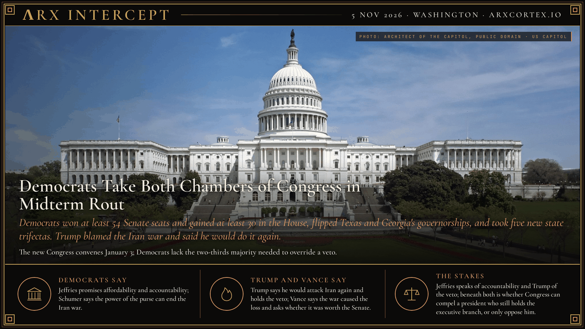

**ΛRX INTERCEPT** · Dispatch · 5 Nov 2026 · Washington

# Democrats Take Both Chambers of Congress in Midterm Rout

*Democrats won at least 54 Senate seats and gained at least 30 in the House, flipped Texas and Georgia's governorships, and took five new state trifectas. Trump blamed the Iran war and said he would do it again.*

Democrats won the Senate at least 54-44 and took the House, flipping Texas and Georgia's governorships. For the first time in his second term Trump faces a Congress that can investigate him. He blamed the Iran war, and said he would do it again.

Voters elected Democratic majorities in both chambers on Tuesday, ending unified Republican control of Washington. Reuters put the Senate at least 54-44 for Democrats, with Alaska and Mississippi still uncalled and the majority able to reach 56-44. Democrats gained at least 30 House seats. The party flipped Senate seats in Texas, Kansas and South Carolina, states Trump carried comfortably in 2024; Abdul El-Sayed won Michigan's open seat and became the first Muslim elected to the Senate.

The state map moved with them. Democrats won the governorship and both legislative chambers in Michigan, Minnesota, Nevada, Pennsylvania and Wisconsin, according to AP tallies reported by NBC News. Gina Hinojosa defeated three-term Governor Greg Abbott in Texas, the first Democrat to win that office since 1990. Keisha Lance Bottoms won Georgia and became the first Black woman elected governor in American history. Democrats also won governorships in Iowa and Ohio, breaking Republican trifectas there.

House Democratic Leader Hakeem Jeffries, on track to become speaker when the new Congress convenes on 3 January, said the incoming majority would focus on affordability and accountability. "We don't work for Donald Trump," he told reporters on Wednesday. "We work for the American people." Senate Democratic Leader Chuck Schumer said Congress would use its control of federal spending to end the Iran war, calling the power of the purse the founders' answer to a president who fights without the public's consent.

Trump acknowledged that the war had driven up gasoline prices and cost his party. He defended the decision anyway. "The Iran thing we had to do, and we continue to do it," he told reporters, adding that he would do it again because Iran could not have a nuclear weapon. He also reminded Democrats that he holds the veto. Vice President JD Vance wrote that the war caused the defeat and invited Republicans to defend the trade openly: argue that losing the Senate for six years was a worthwhile cost.

Republicans still govern until January, and Speaker Mike Johnson said he would not lead his caucus next year. They face at least one must-pass spending bill in December during the lame-duck session. Democrats take office without the two-thirds majority needed to override a veto in either chamber. Trump keeps command of the military and the executive branch; Congress gains subpoenas, hearings and the power to deny him money and nominees.

Jeffries speaks of accountability and Trump of the veto; beneath both is whether Congress can compel a president who still holds the executive branch, or only oppose him.

---

## Sources

**Original reporting**
- [Democrats flex congressional majorities as Trump accepts electoral losses](https://www.reuters.com/5f374b32b07b/legal/government/democrats-seize-congress-sweeping-midterm-repudiation-trump-2026-11-04/) — Reuters
- [Democrats win US House and Senate, taking full control of Congress](https://apnews.com/article/midterm-election-house-senate-democrats-republicans-trump-f126e12e05b579a327b98481c0ae2226) — AP
- [Trump acknowledges Iran war after Democrats sweep Congress](https://apnews.com/article/congress-democratic-blue-wave-midterms-house-senate-9c5c4c5283f58b1ae0786e2f410c21a0) — AP
- [Democrats gain full control of five state governments, further expanding their power](https://www.nbcnews.com/politics/2026-election/democrats-gain-full-control-five-state-governments-expand-power-rcna607433) — NBC News

**Context**
- [Hakeem Jeffries poised to make history as first Black House Speaker](https://apnews.com/article/hakeem-jeffries-election-house-democrats-017ab70f264d4abe90da0325c1f03350) — AP

**Framing**
- [Iran, Gaza, Ukraine: What will US midterm results mean for these conflicts?](https://www.aljazeera.com/news/2026/11/5/iran-gaza-ukraine-what-will-us-midterm-results-mean-for-these-conflicts) — Al Jazeera

*Filed by the ΛRX Intercept desk · arxcortex.io*

*Written from the sources above. Photo: Architect of the Capitol, the Capitol's west front, Wikimedia Commons (public domain).*
