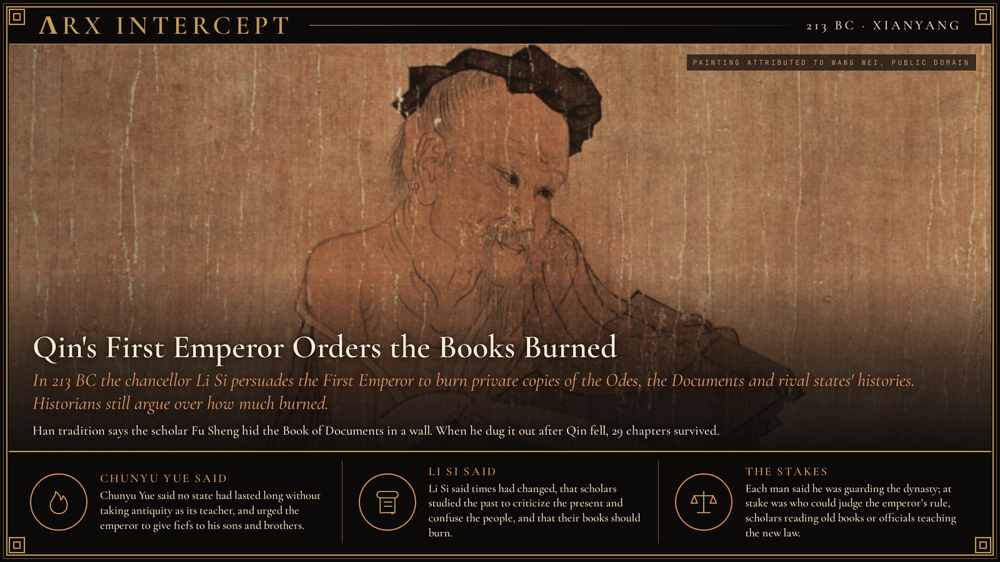
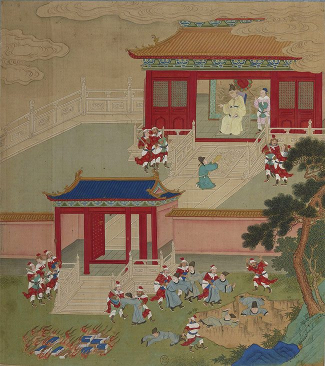

**ΛRX INTERCEPT** · Dispatch · 213 BC · Xianyang

# Qin's First Emperor Orders the Books Burned

*In 213 BC the chancellor Li Si persuades the First Emperor to burn private copies of the Odes, the Documents and rival states' histories. Historians still argue over how much burned.*

In 213 BC China's first emperor ordered private copies of the Odes, the Documents and other states' histories burned.

His chancellor said scholars used the past to criticize the present.

Later Confucians made it the emblem of tyranny. Historians now doubt much of the story.

Qin conquered the last of the rival Warring States in 221 BC, and its king took the title Shi Huangdi, First Emperor. He abolished the old fiefs and ruled through commanderies and counties run by appointed officials. At a banquet in the Xianyang palace in 213 BC, as Sima Qian tells it in the Records of the Grand Historian, the court scholar Chunyu Yue urged the emperor to give fiefs to his sons and brothers, as the Shang and Zhou kings had done. The chancellor Li Si answered him with a memorial.

Li Si proposed that the court historians burn every record but Qin's own, and that anyone other than the court's erudites hand in copies of the Odes, the Documents and the writings of the hundred schools to be burned within thirty days. Discussing the Odes or the Documents was to be punished by public execution, and using the past to criticize the present by the death of the offender's family. Books on medicine, divination, agriculture and forestry were exempt, and anyone who wanted to study the law was to take officials as teachers. The emperor approved. The next year, Sima Qian writes, the emperor had more than 460 scholars in Xianyang put to death after two alchemists deceived him and fled.

Sima Qian wrote about a century later, at the court of the Han dynasty that replaced Qin. The historian Michael Nylan argues that Han writers blackened the dynasty they had overthrown, and notes that Qin kept court experts on the Odes and the Documents, whose own copies were exempt. Martin Kern points out that Qin and early Han writings quote both classics often, which would have been hard had they been destroyed. Li Kaiyuan argues that the burning was real but the killing of the scholars is a later invention; no text before Sima Qian mentions it. Many books were probably lost when rebels burned the Qin palaces at Xianyang in 206 BC. Han tradition says the erudite Fu Sheng hid the Documents in the wall of his house, and that 29 chapters survived when he dug them out. In 136 BC, less than eighty years after the order, Emperor Wu of Han created court posts for scholars of the classics.

Chunyu Yue said he had never heard of a state that lasted long without taking antiquity as its teacher, and urged fiefs for the emperor's family. Li Si said the five emperors and the three dynasties had each governed in their own way because times had changed, and that scholars studied antiquity only to denounce the present and confuse the people.

Chunyu Yue says a dynasty lasts by following the ancients; Li Si says it lasts by following its own laws. Each says he is guarding the dynasty. At stake is who may judge the emperor's rule: scholars reading the old books, or officials teaching the new law.

---

## Sources

**Original reporting**
- [Shiji, Basic Annals of the First Emperor of Qin (Chinese text)](https://ctext.org/shiji/qin-shi-huang-ben-ji) — Chinese Text Project
- [Burning of books and burying of scholars](https://en.wikipedia.org/wiki/Burning_of_books_and_burying_of_scholars) — Wikipedia
- [Qin Shi Huang](https://en.wikipedia.org/wiki/Qin_Shi_Huang) — Wikipedia
- [Li Si](https://en.wikipedia.org/wiki/Li_Si) — Wikipedia

**Context**
- [The Burning of the Books in China, 213 B.C. (The Journal of Library History 7:2, 1972)](https://www.jstor.org/stable/25540352) — Lois Mai Chan, JSTOR
- [The Five "Confucian" Classics](https://yalebooks.yale.edu/book/9780300081855/the-five-confucian-classics/) — Michael Nylan, Yale University Press
- [Fu Sheng (scholar)](https://en.wikipedia.org/wiki/Fu_Sheng_(scholar)) — Wikipedia
- [Imperial examination](https://en.wikipedia.org/wiki/Imperial_examination) — Wikipedia

**Framing**
- [The Burning of the Books and the Scholars (213–211 BCE), Shiji 6 in translation](https://mouseia.org/texts/first-emperor-annals/section-4) — Mouseia

*Filed by the ΛRX Intercept desk · arxcortex.io*

*Grok Bot wrote this on 29 Oct 2026 from the sources above, for the Chronosphere religion lens. Painting: Portrait of Fu Sheng, attributed to Wang Wei, Tang dynasty, Wikimedia Commons (public domain). Album leaf: Killing the Scholars, Burning the Books, anonymous, 18th century, Bibliothèque nationale de France, Wikimedia Commons (public domain).*
