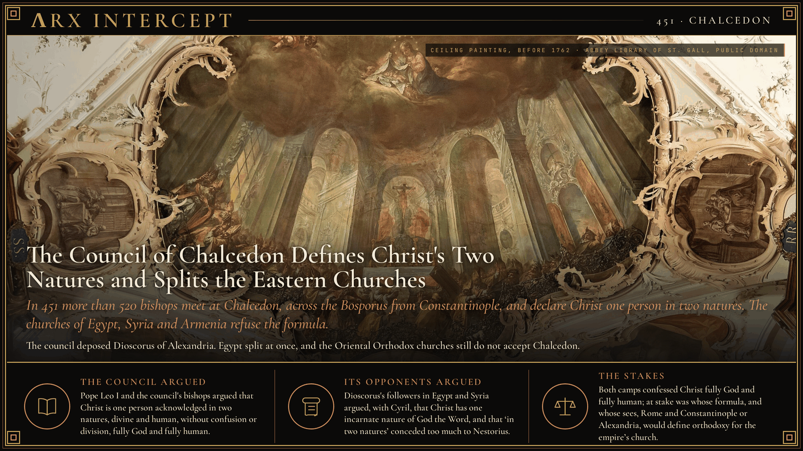
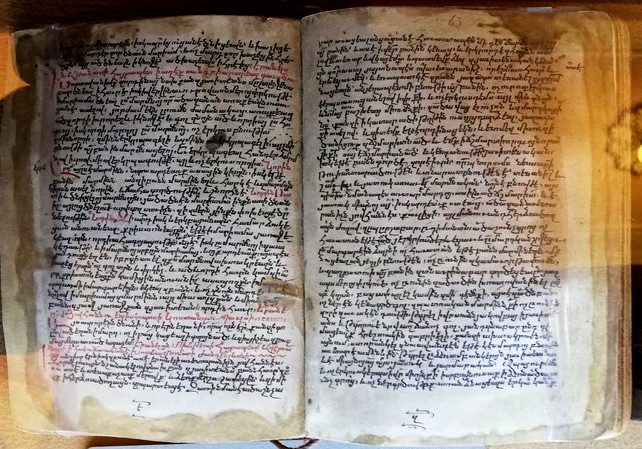

**ΛRX INTERCEPT** · Dispatch · 451 · Chalcedon

# The Council of Chalcedon Defines Christ's Two Natures and Splits the Eastern Churches

*In 451 more than 520 bishops meet at Chalcedon, across the Bosporus from Constantinople, and declare Christ one person in two natures. The churches of Egypt, Syria and Armenia refuse the formula.*

In 451 more than 520 bishops met at Chalcedon, across the Bosporus from Constantinople, and declared Christ one person "in two natures, without confusion, without change, without division, without separation". The churches of Egypt, Syria and Armenia refused the formula.

The Definition remains the teaching on Christ of the Eastern Orthodox, Catholic and most Protestant churches. The Coptic, Syriac, Armenian, Ethiopian, Eritrean and Malankara churches, the Oriental Orthodox, still do not accept the council, and the split it opened has never fully closed.

The quarrel began in Constantinople. About two years after Cyril of Alexandria died in 444, an aged monk named Eutyches taught that Christ was "of two natures before the union, but after the union, one nature". In November 448 a synod under Flavian, bishop of Constantinople, condemned him. Dioscorus, bishop of Alexandria, took up his cause, and in 449 a council at Ephesus with Dioscorus presiding restored Eutyches and deposed Flavian, who died soon after. Pope Leo I, whose letter on the question, the Tome, had not been read there, called the meeting a latrocinium, a "robber council".

When Theodosius II died in 450, the new emperor Marcian, married to Theodosius's sister Pulcheria, called a fresh council. Leo wanted it in Italy; Marcian held it in the church of the martyr Euphemia at Chalcedon, facing the capital, from 8 October to 1 November 451.

The bishops heard Leo's Tome and cried out, "Peter has spoken thus through Leo." They deposed Dioscorus, on charges of breaking church law rather than of heresy, after he stayed away from the third session on despite an imperial summons. He died in exile at Gangra in 454. When no agreed statement emerged, the papal legate Paschasinus threatened to take the council back to Italy, and Marcian told the bishops they would have to move unless a clause was added. A committee then drafted the Definition: one and the same Christ, "truly God and truly man", consubstantial with the Father in his godhead and with us in his manhood. In a canon later numbered 28, the council also gave Constantinople, "New Rome", privileges equal to those of Rome, and in another session it freed Jerusalem from the authority of Antioch.

Egypt split at once. Some 30,000 Greek-speaking Chalcedonians under Proterius faced a far larger Coptic following of Dioscorus under Timothy II, and Antioch divided along similar lines. Copts still call the council "Chalcedon, the Ominous". The churches that refused it reject the label "monophysite", used against them by imperial Christians, and call their teaching miaphysite: Christ's divinity and humanity united in "one incarnate nature" of God the Word, a phrase taken from Cyril.

Modern talks have narrowed the gap. In May 1973 Pope Shenouda III of Alexandria and Pope Paul VI signed a common declaration on the nature of Christ, and by 1989 Eastern Orthodox and Oriental Orthodox theologians had reached agreement on Christology, but the churches remain out of communion.

Pope Leo I and the council's bishops argued that Christ is one person acknowledged in two natures, divine and human, without confusion or division. Dioscorus's followers in Egypt and Syria argued, with Cyril, that Christ has one incarnate nature of God the Word, and that "in two natures" conceded too much to Nestorius.

Both camps confessed Christ fully God and fully human. At stake was whose formula, and whose sees, Rome and Constantinople or Alexandria, would define orthodoxy for the empire's church.

---

## Sources

**Original reporting**
- [Council of Chalcedon](https://en.wikipedia.org/wiki/Council_of_Chalcedon) — Wikipedia
- [Council of Chalcedon](https://grokipedia.com/page/Council_of_Chalcedon) — Grokipedia
- [Chalcedonian Definition](https://en.wikipedia.org/wiki/Chalcedonian_Definition) — Wikipedia

**Context**
- [Pope Dioscorus I of Alexandria](https://en.wikipedia.org/wiki/Pope_Dioscorus_I_of_Alexandria) — Wikipedia
- [Second Council of Ephesus](https://en.wikipedia.org/wiki/Second_Council_of_Ephesus) — Wikipedia
- [Oriental Orthodox Churches](https://en.wikipedia.org/wiki/Oriental_Orthodox_Churches) — Wikipedia

**Framing**
- [Miaphysitism](https://en.wikipedia.org/wiki/Miaphysitism) — Wikipedia
- [Chalcedonian Christianity](https://grokipedia.com/page/Chalcedonian_Christianity) — Grokipedia

*Filed by the ΛRX Intercept desk · arxcortex.io*

*Written on 3 Nov 2026 from the sources above, for the Chronosphere religion lens. Art: Joseph Wannenmacher, ceiling painting of the Council of Chalcedon (before 1762), Abbey Library of St. Gall, Wikimedia Commons (public domain). Manuscript: Armenian translation of a Coptic treatise against Chalcedon, 1476, Matenadaran, Wikimedia Commons (CC0).*
